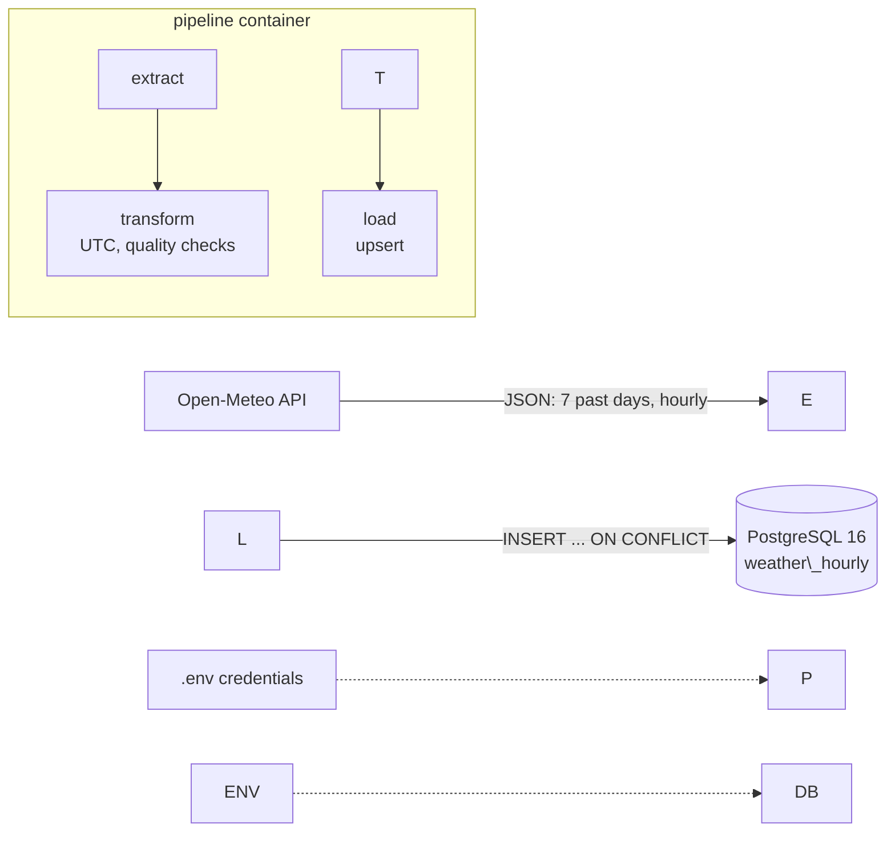

# Weather Data Pipeline

An ETL pipeline that pulls hourly weather data for **Nantes** and **Casablanca** from the [Open-Meteo](https://open-meteo.com) API, cleans and validates it with Python, and loads it into **PostgreSQL**. The whole system runs in **Docker Compose**: one command starts the database and one command runs the pipeline.

!\[tests](https://github.com/grithubber8/weather-data-pipeline/actions/workflows/tests.yml/badge.svg)
!\[Python](https://img.shields.io/badge/Python-3776AB?logo=python\&logoColor=white)
!\[PostgreSQL](https://img.shields.io/badge/PostgreSQL\_16-4169E1?logo=postgresql\&logoColor=white)
!\[Docker](https://img.shields.io/badge/Docker\_Compose-2496ED?logo=docker\&logoColor=white)
!\[pytest](https://img.shields.io/badge/tests-pytest-0A9EDC?logo=pytest\&logoColor=white)

**What this project demonstrates:** an extract-transform-load design where every run is safe to repeat (idempotent), timestamps are stored in UTC, bad data is filtered and logged, secrets stay out of the code, tests run automatically on every push, and the entire system can be rebuilt from nothing in three commands.

\---

## Architecture



|Stage|What it does|
|-|-|
|**Extract**|Calls the API with a 30-second timeout and fails loudly on any HTTP error|
|**Transform**|Renames columns to match the table (units in the names), converts times to timezone-aware UTC, drops forecast hours, drops rows with no measurements, rejects impossible values and logs a warning|
|**Load**|Upserts rows in a single transaction: if `(city, observed\_at)` already exists, it is updated, not duplicated|

## Quick start

You need Docker Desktop (with Docker Compose) and Git.

```bash
git clone https://github.com/grithubber8/weather-data-pipeline.git
cd weather-data-pipeline

cp .env.example .env          # then edit .env and choose your own password

docker compose up -d                  # start PostgreSQL (creates the table on first run)
docker compose run --rm pipeline      # run the pipeline once
```

Look at the data:

```bash
docker compose exec db psql -U pipeline -d weather -c "SELECT city, count(\*), max(observed\_at) FROM weather\_hourly GROUP BY city;"
```

Run the tests locally (Python 3.15 was used for development):

```bash
python -m venv .venv
source .venv/Scripts/activate        # Windows Git Bash; on macOS/Linux: source .venv/bin/activate
pip install -r requirements-dev.txt
pytest
```

## Design decisions

|Decision|Reason|
|-|-|
|`PRIMARY KEY (city, observed\_at)` plus `ON CONFLICT DO UPDATE`|Makes every run **idempotent**: running the pipeline twice gives the same table as running it once|
|Timestamps stored as `TIMESTAMPTZ` in **UTC**|UTC has no daylight saving, so an hour can never appear twice or vanish (see the time zone demo below)|
|Units in column names (`temperature\_c`, `wind\_speed\_kmh`)|Nobody has to guess units later|
|Load inside one transaction (`with connection:`)|A failure halfway through rolls everything back, so the table never holds half a run|
|Credentials in `.env`, never in code or in the image|`.env` is git-ignored and `.dockerignore`d; `.env.example` documents the settings|
|Health check on the database + `depends\_on: service\_healthy`|The pipeline starts only when PostgreSQL accepts connections|
|Pipeline defined as a `jobs` profile|It is a job that runs and exits, not a server that stays on|
|Database volume (`pgdata`)|Data survives container removal; `docker compose down -v` is the only thing that deletes it|
|Transform logic kept in a pure function|It can be unit-tested without a database or internet access|
|GitHub Actions runs the tests on every push|A clean machine catches "works on my laptop" problems and keeps the main branch trustworthy|

## Data quality and tests

The transform step drops forecast hours (the table is named `observed\_at`), drops rows where every measurement is missing, keeps rows with partially missing values as `NULL`, and rejects physically impossible values (temperature outside -60 to 60 °C, negative rain or wind) with a logged warning instead of silently discarding them.

`pytest` runs 9 unit tests with no database and no network, both locally and automatically on GitHub Actions. Writing them caught a real bug: a column consisting only of nulls was stored as text-like `None` values and crashed the range check. Measurement columns are now forced to numeric types before validation.

## Logging and the time zone demo

The pipeline uses Python's `logging` module instead of `print`, so every line carries a timestamp and a severity level. The same pipeline was run twice, about 11 minutes apart: once inside the container and once directly on a laptop in Shenzhen (UTC+8, no daylight saving).

|Where it ran|Log line|
|-|-|
|Docker container (UTC)|`2026-11-22 17:00:44,961 INFO Nantes: extracted 336, loaded 186 rows`|
|Laptop (Shenzhen, UTC+8)|`2026-11-23 01:11:37,503 INFO Nantes: extracted 336, loaded 186 rows`|

The log labels differ by 8 hours, but the two runs were only 11 minutes apart (17:00 UTC and 17:11 UTC). Both wrote identical rows, because the stored `observed\_at` values are always UTC. Local-time labels are fine for reading logs. They must never be used as stored keys.

!\[Container run in UTC next to a local run in UTC+8](docs/time-zone-demo.png)

## Verified behaviour

|Check|Result|
|-|-|
|Run the pipeline twice|Row counts unchanged (no duplicates)|
|`docker compose down -v`, then `up -d`, then `run`|The database and table were recreated and both cities reloaded: **186 rows each**|
|Unit tests|9 passed locally and on GitHub Actions|

## Troubleshooting

* **`lookup auth.docker.io: no such host` during `docker compose build`:** your network could not reach Docker Hub. Retry after a short wait, or pull the base image once with `docker pull python:3.15-slim` on a network where it works. Builds then use the local copy.
* **`password authentication failed`:** the password in `.env` differs from the one the database volume was first created with. Either restore the old password or recreate the volume with `docker compose down -v` (this deletes the stored data).

## Repository contents

```
weather-data-pipeline/
├── .github/workflows/tests.yml   # runs the tests on every push
├── pipeline.py                   # extract, transform, load
├── tests/test\_transform.py       # unit tests for the transform step
├── sql/init.sql                  # table definition, run on first database start
├── Dockerfile                    # image for the pipeline job
├── docker-compose.yml            # PostgreSQL + the pipeline job
├── requirements.txt              # runtime dependencies (pinned)
├── requirements-dev.txt          # adds pytest
├── pytest.ini
├── .env.example                  # template for credentials (copy to .env)
└── docs/time-zone-demo.png
```

## Data source

Weather data by [Open-Meteo.com](https://open-meteo.com) (attribution required; check their terms of use before any commercial use).

## Limitations and next steps

* **Modelled data, not station readings.** Open-Meteo returns model output, so `observed\_at` means "the model's value for that hour".
* **No incremental loading.** Each run re-fetches the last 7 days and upserts them. A watermark (load only what is newer) would be the next improvement.
* **No scheduler, retries or alerting.** Runs are triggered by hand. Next: an orchestrator (Airflow or Dagster) with retries.
* **No backups.** The database volume lives on the local disk. Production use would add scheduled `pg\_dump` backups.
* **CI covers unit tests only.** It does not yet build the Docker image or run the pipeline against a database. Next: add a job that builds the image and runs an integration test against a PostgreSQL service container.
* **Next layers:** dbt models and data tests on top of `weather\_hourly`, and a cloud deployment.

## Author

Eunice Agogo · [LinkedIn](https://www.linkedin.com/in/eunice-agogo)

